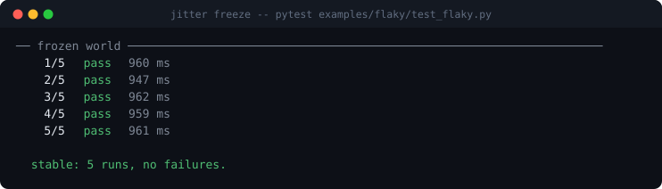

# jitter

<p align="center">
  
  
  
  
</p>

**Your CI already knows the test is flaky. It has never once told you why.**

So you rerun it. It passes. You add a `sleep`. It passes for a month. Then it
fails on a Tuesday and you rerun it again.

`jitter` runs the command a few hundred times under a controlled matrix of
twelve isolated sources of nondeterminism, works out statistically which ones
matter, then shrinks the failure to the smallest configuration that still
breaks — and replays that until it can tell you it failed ten times out of ten.

```bash
jitter run -- pytest tests/test_upload.py
```

![A dark terminal. The heading reads "jitter: pytest examples/flaky/test_flaky.py -k state", then in red "caused by order". Two rows show frozen at 0%, 0 of 10 trials failed, and shaken at 30%, 3 of 10 trials failed. A table titled "what matters" has one row: order, shaken alone 3/10, all but this 0/10, p 0.105, verdict "confirmed". Eleven other knobs are collapsed into a single "cleared" line. A final section, "the repro", says one of twelve knobs is enough — order, shuffled with seed 1734209340 — and "verified: failed 8 of 8 replays"](docs/images/study.svg)

A flake that fails 8 out of 8 is not a flake any more. It is a bug with a
repro, and you can put a breakpoint in it.

## Install

```bash
pip install -e .        # or: pipx install .
```

Python 3.9+. No dependencies, and none coming.

## What it shakes

Twelve knobs. Each is pinned to a fixed value or drawn from a pool, and nothing
else about the run changes.

| knob | what it perturbs |
|---|---|
| `order` | the order tests run in — pytest collection and unittest methods |
| `fsorder` | what order `os.listdir`, `os.scandir`, `os.walk` and `Path.iterdir` return |
| `hashseed` | `PYTHONHASHSEED`, so set and dict-of-strings iteration order moves |
| `threads` | `sys.setswitchinterval` — preempt between almost every bytecode, or almost never |
| `sleep` | scales every `time.sleep` down, so a sleep standing in for a lock fails |
| `gc` | collection thresholds, down to collecting on almost every allocation |
| `tz` | `TZ`, from a pool of +14:00, 45-minute offsets, backwards DST |
| `clock` | anchors `time.time` and `datetime.now` ten seconds before midnight, or on a leap day |
| `locale` | `LC_ALL` — month names, decimal separators, collation |
| `env` | terminal width, environment ordering, and junk padding |
| `tmpdir` | a temp path that is very long, or has spaces, or is not ASCII |
| `load` | competing processes, so the machine behaves like CI and not like your laptop |

`jitter knobs -v` prints why each one is worth shaking.

## How it decides

Four questions, and the last two are the ones that matter:

1. **Freeze.** Every knob pinned. If it still fails every time, it is not
   flaky, it is broken — jitter says so and stops.
2. **Chaos.** Every knob shaken. If this is no worse than frozen, jitter
   cannot explain your flake, and says that too.
3. **Solo.** One knob shaken, the rest pinned. A knob that fails here is
   **sufficient** on its own.
4. **Leave-one-out.** Everything shaken *except* one knob. A knob whose
   absence collapses the failure rate is **necessary** — even when it does
   nothing alone.

That fourth question is the one you cannot ask by hand. A test that only fails
when the clock is near midnight *and* the machine is loaded shows nothing under
any single-variable experiment, and jitter finds it.

Three things keep the answer honest:

- **Paired trials.** Cell *i* uses the same seed in every condition, so the
  value a knob draws in its solo cell is the value it draws in chaos.
- **Shuffled execution.** The order trials run in is randomised, so the machine
  getting busier partway through smears across every cell as noise instead of
  landing on whichever ran last.
- **Exact statistics.** Fisher's exact test, one-sided, because normal
  approximations at n = 12 invent significance in exactly the direction that
  would make jitter confident and wrong. Corrected across all twelve knobs with
  Holm–Bonferroni, since testing a dozen hypotheses at p < 0.05 otherwise
  convicts someone innocent about half the time.

Then it delta-debugs the shaken set down — removing knobs while the failure
survives — and replays the survivor. **Ablation beats the screen:** if removing
a knob reliably makes the failure vanish and putting it back brings it straight
back, that is direct causal evidence, and jitter reports it as `confirmed` even
when the p-value alone was not decisive.

## The frozen world

`jitter freeze` skips the investigation and just runs your command with every
knob pinned. Ten deliberately-flaky tests become deterministic:



It exits non-zero if anything fails, which makes it a CI gate:

```yaml
- run: jitter freeze -n 5 -- pytest tests/
```

A failure there means the flakiness is coming from something jitter does not
control — the network, a shared database, another machine — and it says so
rather than guessing.

## Prove it to yourself

`examples/flaky/test_flaky.py` has ten tests, each flaky for exactly one
reason, and none of them contrived: golden output recorded under a different
hash seed, a test that only passes because it runs second, a daily cache key
that straddles midnight, a `sleep` standing in for synchronisation.

```bash
jitter run -- pytest examples/flaky/test_flaky.py -k fsorder   # blames fsorder
jitter run -- pytest examples/flaky/test_flaky.py -k state     # blames order
jitter run -- pytest examples/flaky/test_flaky.py -k tz        # blames tz
```

CI asserts this on every push: if jitter names the wrong knob, the build fails.

## Any language, honestly labelled

Eight of the knobs are environment variables and process behaviour, so they
work on `go test`, `cargo test`, `npm test`, anything. Four need Python — they
are installed by a shim that rides in on `PYTHONPATH` and touches nothing in
your project. Point jitter at a non-Python command and it drops those four and
tells you it did, rather than reporting twelve knobs when it measured eight.

## Commands

```
jitter run     [-n N] [--screen N] [-j N] [--seed S] [--strict] [--report F] -- CMD
jitter freeze  [-n N] -- CMD            run it with every knob pinned
jitter replay  [STUDY] [-n N]           run the stored failing configuration again
jitter repro   [STUDY] [-o FILE]        a standalone bash script that reproduces it
jitter show    [STUDY] [--json]         reprint a study
jitter report  [STUDY] [-o F] [--open]  one self-contained HTML page
jitter list                             every study recorded here
jitter knobs   [-v]                     what it can shake, and why
```

Useful flags: `--knob order --knob fsorder` to shake only those, `--exclude
load` to leave one out, `--fail-on 'FAILED|Traceback'` when the command does not
bother with exit codes, `--expect-code 2` when a non-zero code is the pass.

Studies land in `.jitter/runs/<name>.json` — plain JSON, safe to commit or
throw away.

## What it cannot do

It shakes the world around your process, not the world beyond it. Real network
timing, a database another job is writing to, a genuinely random seed drawn
from `os.urandom`, a bug that needs one specific machine — none of those are
reachable from here. When the frozen world still fails, jitter tells you that
plainly instead of blaming the nearest knob.

`clock` is never pinned, only shaken: freezing wall-clock time breaks TLS
verification and cache expiry, so the frozen baseline runs on the real clock
and `clock` is measured against it.

## Design

[`docs/DESIGN.md`](docs/DESIGN.md) covers the injection mechanism, why a
configuration is nothing but a dict of strings, and where the statistics can
still mislead you.

MIT.
