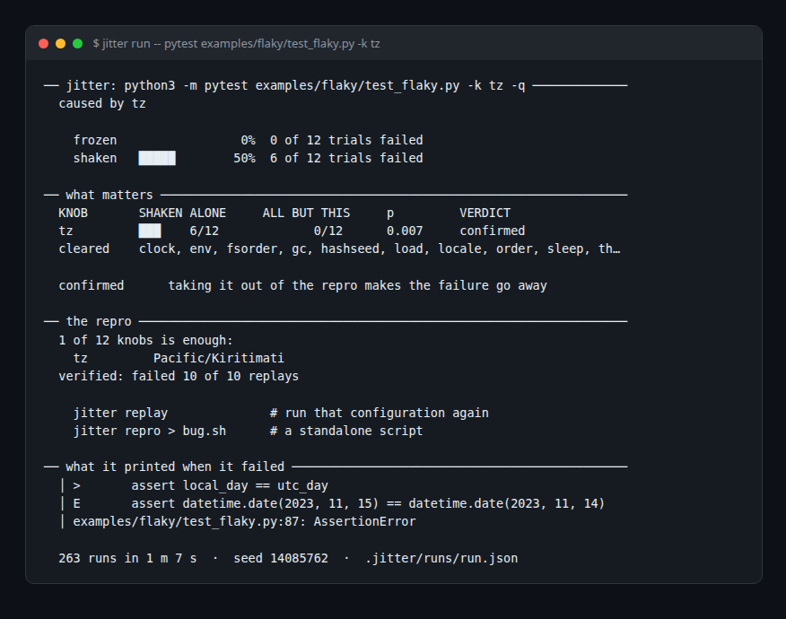
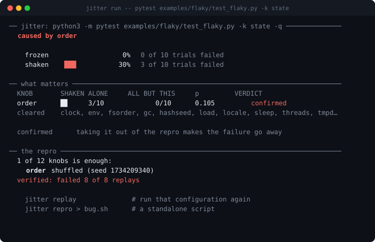

<div align="center">

# jitter
### Your CI already knows the test is flaky. It has never once told you why.

[](https://github.com/nikhilcherry/jitter/actions/workflows/ci.yml)    



<sub>A real run (the pytest traceback is trimmed). One knob out of twelve blamed, and a configuration that fails every time.</sub>

</div>

You rerun the test. It passes. You add a `sleep`. It passes for a month. Then it fails on a Tuesday.

`jitter` runs your command a few hundred times under a controlled matrix of **twelve isolated sources of nondeterminism**, works out statistically which ones matter, shrinks the failure to the smallest configuration that still breaks, and replays it until it can say it failed ten times out of ten. A flake that fails 10 out of 10 is not a flake any more. It is a bug with a repro, and you can put a breakpoint in it.

| 12 | 0 | 10 / 10 | ~1 min |
|:---:|:---:|:---:|:---:|
| knobs shaken: order, hash seed, timezone, clock, threads and more | dependencies, and none coming | verified replays of the minimal repro | to blame a timezone flake (263 runs) |

## 40-second demo

<p align="center"><a href="https://youtu.be/BsvzVi-R1Xg"></a><br><sub>▶ Watch the 40-second demo on [YouTube](https://youtu.be/BsvzVi-R1Xg) (with sound), or grab the [mp4](docs/media/demo.mp4). Every image in it is a real screenshot or run from this repo.</sub></p>

## Try it

```bash
pip install -e .        # Python 3.9+, or: pipx install .
jitter run -- pytest tests/test_upload.py
jitter run -- pytest examples/flaky/test_flaky.py -k tz      # a flake that is genuinely about timezones
```

`examples/flaky/test_flaky.py` has ten tests, each flaky for exactly one reason and none contrived: golden output recorded under another hash seed, a test that only passes because it runs second, a daily cache key that straddles midnight, a `sleep` standing in for synchronisation. CI asserts that jitter blames the right knob for every one of them on every push.

## How it decides

Four questions, and the last two are the ones that matter:

1. **Freeze.** Every knob pinned. If it still fails every time, it is not flaky, it is broken, and jitter says so and stops.
2. **Chaos.** Every knob shaken. If this is no worse than frozen, jitter cannot explain your flake, and says that too.
3. **Solo.** One knob shaken, the rest pinned. A knob that fails here is **sufficient** on its own.
4. **Leave-one-out.** Everything shaken *except* one knob. A knob whose absence collapses the failure rate is **necessary**, even if it does nothing alone.

The fourth question cannot be asked by hand. A test that fails only when the clock is near midnight *and* the machine is loaded shows nothing under any single-variable experiment.



## Decisions worth knowing

- **Paired trials.** Cell *i* uses the same seed in every condition, so the value a knob draws solo is the value it draws in chaos.
- **Shuffled execution.** Trials run in random order, so the machine getting busier partway through smears across every cell as noise instead of landing on whichever ran last.
- **Exact statistics.** One-sided Fisher's exact test, because normal approximations at n = 12 invent significance in exactly the direction that makes a tool confident and wrong. Holm-Bonferroni across the twelve knobs, since testing a dozen hypotheses at p < 0.05 otherwise convicts someone innocent about half the time.
- **Ablation beats the screen.** If removing a knob reliably makes the failure vanish and putting it back brings it straight back, that is direct causal evidence. jitter reports `confirmed` even when the p-value alone was not decisive.
- **`clock` is shaken, never pinned.** Freezing wall-clock time breaks TLS verification and cache expiry, so the frozen baseline runs on the real clock.

## Honest limits

- It shakes the world *around* your process, not beyond it: real network timing, a database another job writes to, a seed drawn from `os.urandom`, a bug that needs one specific machine. When the frozen world still fails, it says so instead of blaming the nearest knob.
- **Any language, honestly labelled.** Eight knobs are environment variables and process behaviour, so they work on `go test`, `cargo test` and `npm test`. Four need Python, installed by a shim that rides in on `PYTHONPATH`. Point jitter at a non-Python command and it drops those four and tells you, rather than reporting twelve knobs when it measured eight.

## As a CI gate

`jitter freeze` runs your command with every knob pinned. It exits non-zero if anything fails, and a failure there means the flakiness comes from something jitter does not control (the network, a shared database, another machine).

```yaml
- run: jitter freeze -n 5 -- pytest tests/
```

<details>
<summary>The twelve knobs</summary>

| knob | what it perturbs |
|---|---|
| `order` | the order tests run in — pytest collection and unittest methods |
| `fsorder` | what order `os.listdir`, `os.scandir`, `os.walk` and `Path.iterdir` return |
| `hashseed` | `PYTHONHASHSEED`, so set and dict-of-strings iteration order moves |
| `threads` | `sys.setswitchinterval` — preempt between almost every bytecode, or almost never |
| `sleep` | scales every `time.sleep` down, so a sleep standing in for a lock fails |
| `gc` | collection thresholds, down to collecting on almost every allocation |
| `tz` | `TZ`, from a pool of +14:00, 45-minute offsets, backwards DST |
| `clock` | anchors `time.time` and `datetime.now` ten seconds before midnight, or on a leap day |
| `locale` | `LC_ALL` — month names, decimal separators, collation |
| `env` | terminal width, environment ordering, and junk padding |
| `tmpdir` | a temp path that is very long, or has spaces, or is not ASCII |
| `load` | competing processes, so the machine behaves like CI and not like your laptop |


`jitter knobs -v` prints why each one is worth shaking.

</details>

<details>
<summary>Commands and flags</summary>

```
jitter run     [-n N] [--screen N] [-j N] [--seed S] [--strict] [--report F] -- CMD
jitter freeze  [-n N] -- CMD            run it with every knob pinned
jitter replay  [STUDY] [-n N]           run the stored failing configuration again
jitter repro   [STUDY] [-o FILE]        a standalone bash script that reproduces it
jitter show    [STUDY] [--json]         reprint a study
jitter report  [STUDY] [-o F] [--open]  one self-contained HTML page
jitter list                             every study recorded here
jitter knobs   [-v]                     what it can shake, and why
```

Useful flags: `--knob order --knob fsorder` to shake only those, `--exclude
load` to leave one out, `--fail-on 'FAILED|Traceback'` when the command does not
bother with exit codes, `--expect-code 2` when a non-zero code is the pass.


Studies land in `.jitter/runs/<name>.json`: plain JSON, safe to commit or throw away.

</details>

Design notes (the injection mechanism, why a configuration is just a dict of strings, where the statistics can still mislead): [`docs/DESIGN.md`](docs/DESIGN.md). MIT.
